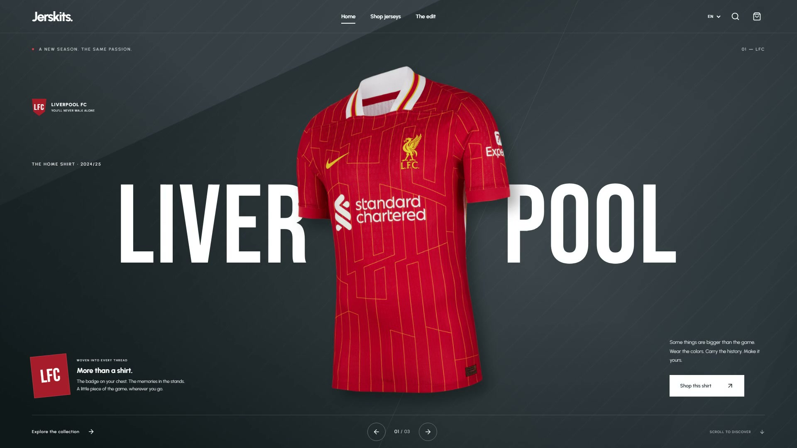

# Jerskits.

A responsive football-shirt storefront built as an independent portfolio demo. Explore 12 club and national-team shirts, select a size, manage a persistent bag and complete a simulated guest checkout. No accounts, backend or payment service.

[Live demo](https://jerskits-marketplace.vercel.app) · [Watch the 35-second film](https://jerskits-marketplace.vercel.app/walkthrough) · [Download MP4](https://jerskits-marketplace.vercel.app/walkthrough/jerskits-showcase.mp4)

[](https://jerskits-marketplace.vercel.app/walkthrough)

The film is a silent visual tour of the desktop collection, shirt details and real mobile experience. [Recording and publication notes](docs/walkthrough.md).

## Run locally

Tested with Node.js 24.13 and npm 11. Use the Node version in `.node-version`.

```sh
npm ci
npm run dev
```

Open the Local URL printed by Vite. Everything needed at runtime, including images, translations and fonts, is served locally.

## Checks

```sh
npm run typecheck
npx playwright install chromium
npm test
```

The browser suite builds the application and exercises observable user behavior against the production preview, with desktop Chromium and a mobile Chromium viewport. It covers discovery, catalogue controls, variant limits, bag persistence, invalid shipping data, demo autofill, simulated orders, English / Brazilian Portuguese / Spanish, reset, keyboard navigation and automated accessibility checks. Each test also fails on browser runtime errors. It does not test internal React components or mock application collaborators.

For one test file, run `npx playwright test tests/cart.spec.ts`. Use `npm run test:ui` for interactive debugging. Browser traces and reports are generated locally and ignored by Git.

## Production preview

```sh
npm run build
npm run preview
```

The output is `dist`. The public demo is hosted on Vercel, with automatic production deployments from the public repository's `main` branch. `vercel.json` configures the SPA rewrite, so direct entry and refresh work on shirt pages, checkout and `/walkthrough`. A `_redirects` file is also included for other hosts that support that convention.

## Demo behavior

- English initially; select EN, PT or ES in the header. The locale and bag survive reloads.
- The homepage fills the first viewport with an immersive hero and overlaid navigation. Use the previous/next controls to switch between Liverpool, Barcelona and Brazil; the product link follows the selected shirt. Switching is manual, with no automatic rotation.
- USD in every locale, final prices, free delivery and a maximum of five units per shirt/size combination.
- Unavailable sizes cannot be selected. Another size of the same shirt creates a separate bag line.
- Required shipping fields: full name, email, country, city and address. Phone and postal code are optional. The example button fills a valid form.
- Order confirmation preserves the purchased items while clearing the bag. No card details are requested and nothing is charged or shipped. Shipping details are not saved in browser storage.
- Reset in the footer clears the bag, returns to English and starts again at the homepage. A confirmation is kept only in its browser-history entry, not as an order-history feature.

## Design and assets

The supplied reference is retained with the [accepted specification](.scratch/jerskits-mvp/spec.md). The implementation follows its clear navigation, dark Liverpool feature, oversized typography and restrained product layouts; unreadable screens are completed in the same style.

Product-photo source URLs, credits and verified kit seasons are recorded in `src/catalog/assets.json`; additional transparent hero images are credited in `src/catalog/hero-assets.json`. The displayed prices are demo values. Local fonts are Urbanist and Bebas Neue, supplied through Fontsource. Brand names identify the example products; this is an independent concept.

## Structure

The application separates catalogue data and queries, cart state and browser persistence, shipping validation, shared interface components, route pages and complete typed locale dictionaries. Routes use React Router and translations use i18next. No environment variables are required.
